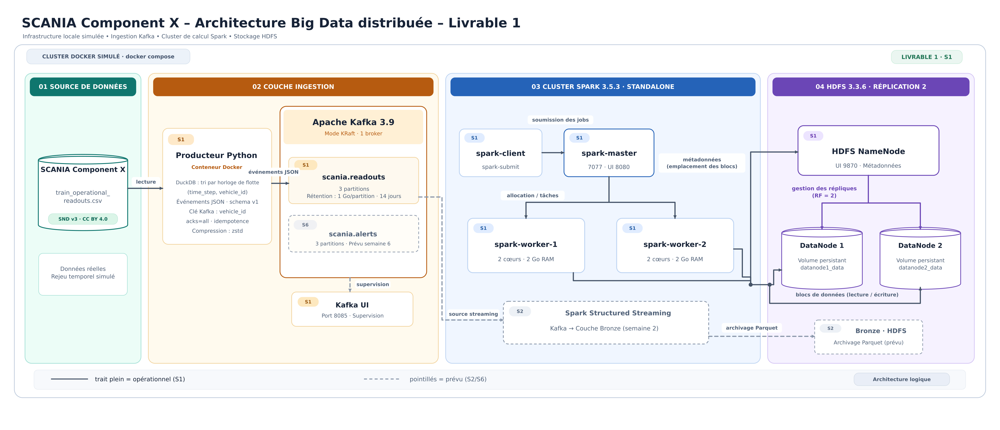

# SCANIA Component X – Plateforme Big Data distribuée de maintenance prédictive

Pipeline Big Data de bout en bout sur données industrielles réelles : ingestion d'événements avec **Kafka**, stockage distribué **HDFS**, traitements **Spark** (SQL, Structured Streaming, MLlib) et prédiction en temps réel des réparations d'un composant moteur de camions Scania.

## Architecture



Source modifiable de l'architecture (Mermaid) : [`docs/architecture/README.md`](docs/architecture/README.md).

## Stack et versions

| Couche | Technologie | Version | Rôle |
|---|---|---|---|
| Ingestion | Apache Kafka (KRaft) | 3.9.0 | 1 broker, topics `scania.readouts` et `scania.alerts` (3 partitions), volume persistant |
| Ingestion | Producteur Python | Python 3.11, confluent-kafka 2.6.1, DuckDB 1.1.3 | Rejeu des relevés SCANIA dans Kafka |
| Supervision | Kafka UI | 0.7.2 | Inspection des topics et messages |
| Stockage | Apache Hadoop HDFS | 3.3.6 | 1 NameNode + 2 DataNodes, réplication 2 |
| Calcul | Apache Spark (standalone) | 3.5.3 | 1 master + 2 workers + 1 client ; Spark SQL, Structured Streaming, MLlib |

## Prérequis et ressources

- **Docker Desktop** avec Docker Compose v2 (sous Windows : backend WSL2).
- **RAM** : 12 à 16 Go recommandés (sinon réduire `SPARK_WORKER_MEMORY` à `1g`).
- **Disque** : environ 10 Go libres pour Docker, plus 1,7 Go pour les données.
- **Ports libres** : 7077, 8085, 8090, 8091, 8092, 9092, 9870.

## Démarrage

### 1. Récupérer le projet

```bash
git clone https://github.com/douasmhmd/scania-bigdata-platform.git
cd scania-bigdata-platform
```

### 2. Télécharger les données (non versionnées)

Linux / macOS :

```bash
mkdir -p data/raw
curl -L -o data/raw/scania.zip "https://api.researchdata.se/dataset/2024-34/3/file/zip"
unzip data/raw/scania.zip -d data/raw && rm data/raw/scania.zip
```

Windows (cmd) :

```
curl.exe -L -o data\raw\scania.zip "https://api.researchdata.se/dataset/2024-34/3/file/zip"
tar -xf data\raw\scania.zip -C data\raw
del data\raw\scania.zip
```

Les CSV doivent se trouver dans `data/raw/2024-34-3/data/`.

### 3. Démarrer le cluster

```bash
docker compose up -d
docker compose ps
```

Tous les services doivent être `Up`, sauf `kafka-init` qui crée les topics puis s'arrête (`Exited (0)`).

| Interface | URL | Vérification attendue |
|---|---|---|
| Kafka UI | http://localhost:8085 | Cluster `scania`, 2 topics, 6 partitions |
| HDFS NameNode | http://localhost:9870 | 2 DataNodes *In Service* |
| Spark Master | http://localhost:8090 | 2 workers *ALIVE* |

### 4. Tester l'ingestion

Le producteur trie les relevés selon une horloge de flotte (`time_step`, puis `vehicle_id`) et publie un événement JSON versionné par relevé, avec `vehicle_id` comme clé Kafka.

```bash
docker compose build producer
docker compose run --rm producer --vehicles 20
```

| Option | Rôle | Défaut |
|---|---|---|
| `--vehicles N` | Limiter à N camions | tous |
| `--limit N` | Nombre maximal d'événements | tous |
| `--rate N` | Débit en événements par seconde | maximum |
| `--file` | Fichier source | `train_operational_readouts.csv` |

### 5. Constituer l'historique dans HDFS (couche Bronze)

Dans un terminal dédié, lancer le job Structured Streaming qui archive le topic dans HDFS (Parquet, avec checkpoint pour la reprise) :

```bash
docker exec spark-client /opt/spark/bin/spark-submit --master spark://spark-master:7077 --packages org.apache.spark:spark-sql-kafka-0-10_2.12:3.5.3 --conf spark.jars.ivy=/tmp/.ivy2 --conf spark.cores.max=2 --conf spark.executor.memory=1g /opt/app/streaming/bronze_ingest.py
```

Dans un autre terminal, publier tout l'historique d'entraînement (environ 1,1 million d'événements, quelques minutes) :

```bash
docker compose run --rm producer
```

Copier les fichiers de référence (labels et spécifications) dans HDFS :

```bash
docker exec namenode hdfs dfs -mkdir -p /lakehouse/reference
for f in train_tte train_specifications validation_labels validation_specifications test_labels test_specifications; do
  docker cp "data/raw/2024-34-3/data/$f.csv" "namenode:/tmp/$f.csv"
done
docker exec namenode bash -c "hdfs dfs -put -f /tmp/*.csv /lakehouse/reference/ && rm /tmp/*.csv"
```

Sous Windows PowerShell, remplacer la boucle par :

```powershell
foreach ($f in "train_tte","train_specifications","validation_labels","validation_specifications","test_labels","test_specifications") { docker cp "data\raw\2024-34-3\data\$f.csv" "namenode:/tmp/$f.csv" }
```

### 6. Calculer les indicateurs (Spark SQL)

```bash
docker exec spark-client /opt/spark/bin/spark-submit --master spark://spark-master:7077 --conf spark.cores.max=2 --conf spark.executor.memory=1g /opt/app/batch/indicators.py
```

Les indicateurs sont affichés et sauvegardés dans `/lakehouse/indicators` (HDFS).

## Résultats actuels

| Indicateur | Valeur |
|---|---|
| Événements archivés dans Bronze | 1 123 821 (dont 1 369 doublons identifiés par `event_id`) |
| Camions | 23 550, tous avec un label |
| Relevés par camion | de 5 à 303 (médiane 43) |
| Camions réparés pendant l'étude | 2 272 (9,65 %) |
| Valeurs manquantes | au maximum 0,86 % par variable |

## Vérifications

```bash
# Topics et partitions
docker exec kafka /opt/kafka/bin/kafka-topics.sh --bootstrap-server kafka:29092 --describe --exclude-internal

# Nombre d'événements par partition
docker exec kafka /opt/kafka/bin/kafka-get-offsets.sh --bootstrap-server kafka:29092 --topic scania.readouts

# État de HDFS (2 DataNodes attendus)
docker exec namenode hdfs dfsadmin -report

# Couche Bronze et checkpoint du streaming
docker exec namenode hdfs dfs -du -s -h /lakehouse/bronze/readouts
docker exec namenode hdfs dfs -ls /checkpoints/bronze_readouts

# Test Spark -> HDFS exécuté sur le cluster
docker exec spark-client /opt/spark/bin/spark-submit --master spark://spark-master:7077 /opt/app/tests/spark_hdfs_smoke.py
```

Les preuves d'exécution sont dans [`docs/captures/`](docs/captures/).

## Arrêt

```bash
docker compose down      # arrête le cluster, conserve les données Kafka et HDFS
docker compose down -v   # supprime aussi les volumes (toutes les données effacées)
```

## Structure du dépôt

```
infra/        configurations (hadoop/core-site.xml, hadoop/hdfs-site.xml)
ingestion/    producteur Kafka (Dockerfile, producer.py, requirements.txt)
streaming/    jobs Spark Structured Streaming (bronze_ingest.py)
batch/        traitements Spark SQL (indicators.py) et Spark ML (à venir)
dashboard/    tableau de bord (à venir)
tests/        tests du cluster (spark_hdfs_smoke.py)
docs/         architecture, captures, livrables
data/         données locales, ignorées par Git
```

## Feuille de route

| Semaine | Objectif | État |
|---|---|---|
| S1 | Cluster Docker, HDFS, Spark, ingestion Kafka | ✅ |
| S2 | Kafka → Structured Streaming → HDFS (Bronze), indicateurs Spark SQL | ✅ |
| S3 | Préparation des données, entraînement, évaluation et sauvegarde du pipeline ML | ⏳ |
| S4 | Inférence streaming, base de restitution, tableau de bord | ⏳ |
| S5-S7 | Reprise des requêtes streaming, rapport, vidéo, dépôt final | ⏳ |

## Données et licence

**SCANIA Component X Dataset** (version 3), Swedish National Data Service, licence **CC BY 4.0**, DOI [10.5878/bnh5-ka77](https://doi.org/10.5878/bnh5-ka77).

Kharazian Z., Lindgren T., Magnússon S., Steinert O., Andersson Reyna O. (2025). *SCANIA Component X dataset: a real-world multivariate time series dataset for predictive maintenance*. Scientific Data 12, 493. [doi:10.1038/s41597-025-04802-6](https://doi.org/10.1038/s41597-025-04802-6)

## Équipe

- Mohamed Douas
- Omar Boulahjour
