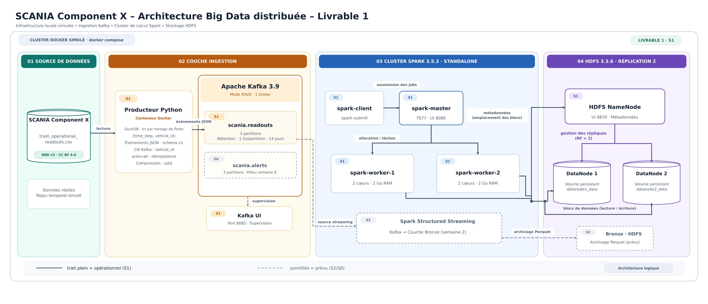

# Livrable 1 – Cluster distribué et couche d'ingestion

## 1. Objectif

Mettre en place un cluster Big Data distribué simulé avec Docker et la couche d'ingestion Kafka du projet de maintenance prédictive sur le dataset réel **SCANIA Component X**.

## 2. Architecture



| Service | Conteneurs | Configuration |
|---|---|---|
| Apache Kafka 3.9.0 (KRaft) | `kafka`, `kafka-init` | 1 broker, topics `scania.readouts` et `scania.alerts` (3 partitions), rétention 1 Go/partition et 14 jours |
| Kafka UI 0.7.2 | `kafka-ui` | Supervision des topics (port 8085) |
| HDFS 3.3.6 | `namenode`, `datanode1`, `datanode2` | Réplication 2, un volume persistant distinct par nœud |
| Spark 3.5.3 standalone | `spark-master`, `spark-worker-1`, `spark-worker-2`, `spark-client` | 2 workers de 2 cœurs et 2 Go ; soumission des jobs depuis `spark-client` |
| Producteur Python | `producer` (à la demande) | Rejeu des relevés SCANIA dans Kafka |

## 3. Couche d'ingestion

### Données

`train_operational_readouts.csv` : 107 colonnes (`vehicle_id`, `time_step` et 105 variables anonymisées : compteurs et histogrammes), avec valeurs manquantes. Le fichier est trié par camion ; `time_step` est un temps relatif, décimal et irrégulier.

### Fonctionnement du producteur

1. **Tri par horloge de flotte** avec DuckDB (`time_step`, puis `vehicle_id`), directement sur le CSV et sans fichier intermédiaire, pour simuler une flotte qui émet en parallèle.
2. **Un événement JSON par relevé**, avec un contrat versionné :

```json
{
  "schema_version": 1,
  "event_id": "0-11.2",
  "vehicle_id": 0,
  "time_step": 11.2,
  "produced_at": "2026-11-07T09:17:40.123456+00:00",
  "readings": {"171_0": 167985.0, "666_0": 10787.0, "167_0": 4110.0, "...": null}
}
```

3. **Clé Kafka = `vehicle_id`** : tous les relevés d'un camion vont dans la même partition, ce qui garantit leur ordre (indispensable pour les calculs avec état des semaines suivantes).
4. **Fiabilité** : `acks=all` et idempotence (ni perte ni doublon côté producteur), compression `zstd`.

## 4. Démonstration

```bash
docker compose up -d
docker compose run --rm producer --vehicles 20
docker exec kafka /opt/kafka/bin/kafka-get-offsets.sh --bootstrap-server kafka:29092 --topic scania.readouts
```

## 5. Résultats et preuves

| Vérification | Résultat | Preuve |
|---|---|---|
| Cluster démarré | 10 conteneurs opérationnels | [docker-compose-ps.txt](captures/docker-compose-ps.txt) |
| Kafka | 1 broker, 2 topics, 6 partitions, rétention appliquée | [kafka-ui-dashboard.png](captures/kafka-ui-dashboard.png), [kafka-topics.txt](captures/kafka-topics.txt), [kafka-topic-config.txt](captures/kafka-topic-config.txt) |
| HDFS | 2 DataNodes actifs ; bloc test avec `Live_repl=2`, statut `HEALTHY` | [hdfs-datanodes.png](captures/hdfs-datanodes.png), [hdfs-fsck-replication.txt](captures/hdfs-fsck-replication.txt), [hdfs-dfsadmin-report.txt](captures/hdfs-dfsadmin-report.txt) |
| Spark | 2 workers actifs ; job test exécuté sur le cluster : 1 000 000 de lignes écrites en Parquet dans HDFS (réplication 2) puis relues | [spark-workers.png](captures/spark-workers.png) |
| Ingestion | 1 369 événements de 20 camions publiés, 0 échec ; répartition 721 / 311 / 337 sur les 3 partitions | [producer-run.png](captures/producer-run.png), [kafka-offsets.txt](captures/kafka-offsets.txt), [kafka-messages.png](captures/kafka-messages.png) |

La répartition inégale entre partitions s'explique par le faible nombre de clés (20 camions) ; elle s'équilibre avec l'ensemble de la flotte (~23 500 camions).

## 6. Difficultés rencontrées et solutions

| Difficulté | Solution |
|---|---|
| Conflits de ports avec d'autres conteneurs locaux | Identification avec `docker ps`, arrêt des services concurrents, ports documentés dans le README |
| Variables Hadoop refusées par Docker Compose dans un `env_file` (tirets interdits) | Configuration par les fichiers natifs `core-site.xml` et `hdfs-site.xml`, montés dans les conteneurs HDFS et Spark |
| Réplication à 3 au lieu de 2 | Le facteur de réplication est choisi par le client qui écrit : la même configuration HDFS est partagée par tous les conteneurs |
| Commande de création des topics découpée par Docker Compose | Script passé comme un seul élément de liste à `sh -c`, avec `set -e` |
| Espace disque limité | Aucun fichier intermédiaire (tri DuckDB à la volée), compression `zstd`, rétention bornée du topic |

## 7. Répartition du travail

| Membre | Contributions |
|---|---|
| Mohamed Douas | Conception de l'architecture et choix techniques (Kafka KRaft, HDFS, Spark standalone)<br>Mise en place du cluster Docker Compose : Kafka, création des topics et Kafka UI ; HDFS (1 NameNode, 2 DataNodes, réplication 2) ; Spark (1 master, 2 workers, 1 client)<br>Développement du producteur Kafka : tri par horloge de flotte avec DuckDB, contrat d'événement JSON versionné, idempotence et compression<br>Tests de validation (réplication HDFS, job Spark vers HDFS) et résolution des incidents d'infrastructure<br>Figure d'architecture et README de lancement |
| Omar Boulahjour | Test de reproductibilité sur une machine vierge en suivant le README, et corrections associées<br>Vérification des preuves d'exécution et des liens de la documentation<br>Description du dataset : variables, licence, découpage officiel train / validation / test<br>Relecture du code et de la configuration |
| Travail commun | Points d'intégration hebdomadaires, validation de l'architecture, préparation de la démonstration |


## 8. Prochaine étape (semaine 2)

Job Spark Structured Streaming lisant `scania.readouts` et archivant les événements dans HDFS (couche Bronze), puis premiers indicateurs en Spark SQL.